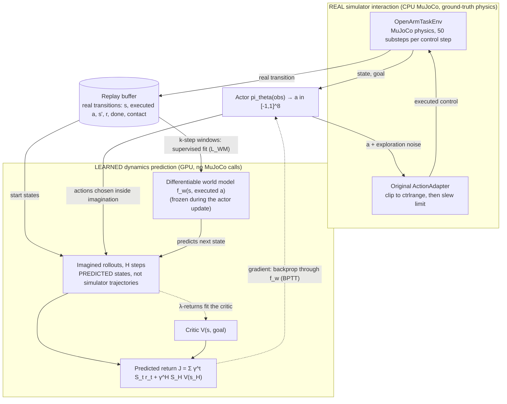

# SuperMimic-OpenArm: model-based actor optimisation through a differentiable world model (research archive v1.0)

**Abstract.** This package adapts the *SuperMimic* recipe (collect → fit one differentiable world model → optimise a policy by back-propagating through short imagined rollouts) to a bimanual **OpenArm v1** MuJoCo scene, using privileged simulator state. A residual MLP world model is fitted on *executed* controls from CPU MuJoCo transitions; an actor is then trained by back-propagating a survival-weighted imagined return (plus a critic bootstrap) through the frozen model. On the simple reaching task (P0) the trained actors reach held-out goals in simulation. A contact-rich pushing task (P1) was brought to a physically validated state (repaired friction, new mass randomisation, goal validity, a scripted expert with 86.7 % strict success), and the world model's contact/free-space prediction and its exploitation by action optimisation were analysed with proxy models. **No P1 or P2 actor was trained to completion**, nothing was validated on a real robot, and the system is **not** a vision-based or fully trained World-Action Model. This archive documents exactly what was built, what was measured, and what remains unverified.

> **Read this first.** Evidence is labelled throughout: **MEASURED** (produced by a tool in this repository; the result files themselves are not archived), **OWNER-REPORTED** (from the project owner's runs on their own workstation; artifacts not in the repository), **EXECUTED NOW** (re-run when this archive was prepared), **UNVERIFIED** (cannot be run in the archival environment). Privileged-state simulation research only: **not Sim2Real**.

## Research status

| Item | IMPLEMENTED | TESTED | TRAINED | EVALUATED | Notes |
|---|:-:|:-:|:-:|:-:|---|
| World model, actor, critic, differentiable imagination, replay, trainer, CLI | yes | yes (unit + pipeline tests) | — | — | CPU MuJoCo env, networks on CUDA |
| **P0 reaching** | yes | yes | **yes** (3 runs × 3,000 it, OWNER-REPORTED) | partly (10 shared goals, 30/30; see limits) | Independent 100-goal evaluation **NOT COMPLETED** |
| **P1 pushing environment** | yes | **yes** (11/11 validation, regression tests) | — | yes (scripted expert 260/300) | friction / mass / goal-validity repaired |
| P1 scripted expert | yes | yes | n/a | **yes** (strict success 86.7 %) | not a learned policy |
| P1 world-model diagnostics and mitigation ablations | yes | yes | proxy models only | yes (proxy) | **KNOWN LIMITATION**: proxy data/models, not a trained P1 actor |
| P1 SuperMimic **actor** | yes (trainer, config, B0–B3 variants) | unit level | **NOT COMPLETED** | **NOT COMPLETED** | no evidence it matches the scripted expert |
| P1 Colab T4 benchmark | yes (driver) | yes (fake-CLI self-test) | — | run once by the owner → **NO-GO** | host RAM and throughput; see below |
| **P2 pick-and-place** | yes (env, task, config) | yes (interfaces) | **NOT COMPLETED** | **NOT COMPLETED** | **KNOWN LIMITATION**: friction/contact defects identified, not repaired; no success claim permitted |
| Real-robot / Sim2Real | no | no | no | no | not attempted |
| Comparison with matched ACT / PPO baselines | PPO and BC baselines exist | smoke only | no | **NOT COMPLETED** | no performance-advantage claim |

## 1. Motivation

Gradient-based actor optimisation through a *learned* differentiable simulator can be far more sample-efficient than model-free RL when the model is accurate, but contact-rich manipulation is exactly where learned dynamics are least reliable and where an optimiser exploits model errors. The research question here is: **can a differentiable learned dynamics model support model-based actor optimisation for OpenArm manipulation?** The answer established so far: yes for free-space reaching (P0, simulation, in-distribution goals); for contact-rich pushing the model predicts contact better than simple baselines but is exploitable under action optimisation, and the actor experiment was not completed.

## 2. Problem formulation

* **State** (privileged simulator state, 34-D): left-arm and gripper joint positions `q` (8), velocities `dq` (8), the previous executed control `prev_ctrl` (8), and for P1/P2 the box pose and velocity (position 3, quaternion 4, linear velocity 3). Right arm is held.
* **Action** `a ∈ [-1,1]^8`: delta joint targets (default parameterisation; `target = prev_ctrl + a · max_step`) for the left arm and gripper, always passed through the repository's **original** `clip → slew-limit` action adapter at 20 Hz (50 MuJoCo substeps of 1 ms per control step).
* **Goal** `g`: a 3-D TCP target (reaching) or a 2-D box target (pushing); the pick-and-place goal is the tray.
* **Reward**: analytic, differentiable functions of the (predicted or real) state; the same function is used for the simulator reward and inside imagination.
* **Objective**: maximise expected return; the actor is updated with `∇_θ J` where `J` is the survival-weighted imagined return of an `H`-step rollout through the frozen model plus `γ^H V(s_H)`.

## 3. Relationship to SuperMimic and differences from the official implementations

This is a SuperMimic-**style** adaptation, **not an exact reproduction** (full audit: [`docs/reproduction_audit.md`](docs/reproduction_audit.md); the paper's PDF was not read, only the abstract page and the reference repositories' READMEs and training code). No source code was copied from the reference implementations; the design (collect → fit → imagine loop, k-step window loss, termination head, frozen model in the actor phase, survival-weighted return with critic bootstrap, element-wise gradient clipping) was re-implemented.

| Aspect | Reference (humanoid, mjlab) | This package |
|---|---|---|
| Task | whole-body humanoid motion tracking | OpenArm reaching / pushing / pick-and-place |
| Simulator | MuJoCo-Warp, thousands of GPU environments | standard MuJoCo on CPU, ≤ 64 process-parallel environments (a Warp backend is **not** implemented) |
| World model | large MLP, goal encoder, latent | residual MLP 512×3 on the *executed* control; `prev_ctrl` set structurally; no goal encoder or latent |
| Actor | encoder/decoder with observation history | plain MLP, no history |
| State | proprioception + motion goal | **privileged simulator state** (box pose/velocity for P1/P2) |
| Scale | hours on one H100 | small; no compute claims are made |

## 4. System architecture



Solid arrows are data flow; **dotted arrows are gradient flow**. Only the upper "REAL" block touches MuJoCo; everything inside "LEARNED" is the model's own prediction. Training loop per iteration: **collect** (policy plus noise; random warm-up) → **fit the world model** → **imagine and update the actor** (+ critic). Details: [`docs/architecture.md`](docs/architecture.md).

## 5. Differentiable world model (`models.py`)

* **Dynamics**: `s' = s + denorm(MLP(norm(s), norm(a_exec)))` (residual, running-normalised, hidden 512 × 3 layers in the shipped configs); `prev_ctrl' := a_exec` is enforced structurally and excluded from the loss.
* **Heads**: termination (BCE with positive weight 5), contact (MSE on finger/hand contact features), optional reward head (not used in the objective: rewards are analytic).
* **Fit**: k-step autoregressive window loss (window 8) on *executed* controls from the replay buffer (windows never cross episode boundaries) plus the head losses; Adam, learning rate 2e-4, gradient-norm clip 1.0.
* **Key diagnostic findings (P1 proxy models)**: see section 10.

## 6. Actor and critic

* **Actor**: MLP (hidden 512 × 3) → `tanh` → `a ∈ [-1,1]^8`; exploration noise (std 0.1) is added by the collector only, never inside imagination.
* **Critic**: `V(s, goal, tcp)` (hidden 256 × 2), trained on λ-returns of detached imagined trajectories (γ 0.99, λ 0.95, 5 epochs × 4 minibatches).
* **Baselines** (same environment, observations, action adapter and goal seeds): PPO (model-free) and behaviour cloning for reaching (`baselines/`). Not benchmarked against SuperMimic here.

## 7. Differentiable imagined rollouts (`imagination.py`, `kinematics.py`)

Start states are sampled from the replay buffer; for `H` steps (8/16/32; 16 in the shipped configs) the actor acts on the *predicted* state, the action is passed through a torch mirror of the original clip → slew adapter (parity-tested against the original), the **frozen** world model predicts the next state, a differentiable forward-kinematics layer (`TorchFK`) gives the TCP position (verified against `mj_forward` to 1e-6), and the analytic reward and the termination probability are evaluated. `J = Σ γ^t S_t r_t + γ^H S_H V(s_H)` with survival `S_{t+1} = S_t (1 − d(s_{t+1}))`. Gradients flow through the dynamics into the actor, with a global norm clip of 1.0 and an element-wise clamp of 0.1; non-finite gradients skip the step (`bad_grads` is logged).

## 8. Data collection from MuJoCo (`envs/`)

`OpenArmTaskEnv` builds the scene with `sim/lab_scene.py` on the **unmodified** upstream OpenArm XML (cloned at a pinned commit by the setup script, never vendored) and applies the original `ActionAdapter` and safety limits on every step. Environments run synchronously or as spawned worker processes (`env.backend: sync | subproc`). Episode seeds are `SeedSequence([train_seed_base, env_idx, episode_idx])` — **independent of `experiment.seed`**. Bit-exact snapshot replay of identical actions (`mj_getState`/`mj_setState` with `mjSTATE_INTEGRATION`) is verified in the test suite.

## 9. Tasks

| Task | Goal / reward summary | Strict success (simulator truth) | Randomisation |
|---|---|---|---|
| **P0 reaching** | TCP to a 3-D target | TCP < 2 cm and TCP speed < 0.10 m/s for 5 consecutive control steps within 100 steps | goal box x 0.32–0.50, y 0.05–0.25, z 0.44–0.58 m |
| **P1 pushing** | `−3·d(box,goal) − 0.5·d(tcp,box) + 2·exp(−(d/0.04)²) − 0.1·lift`; push a 5×4×4 cm box to a goal 7–13 cm away | box within 3 cm, speed < 0.03 m/s, **never lifted > 1 cm**, held 5 steps, 150 steps | box x 0.38–0.48, y 0.06–0.18, yaw ±0.3; friction scale 0.7–1.3 (effective box–desk μ = 0.8 × scale); **mass 0.6–1.6 × 0.05 kg with consistent inertia**; goals rejected if outside the workspace, inside the tray, overlapping obstacles or with a blocked path |
| **P2 pick-and-place** | grasp, lift, carry, release in the tray | lifted earlier, in tray region, at rest, fingers open and **not** touching, 10 steps | box x/y, yaw, friction scale 0.8–1.2 — **friction randomisation partly ineffective, not repaired** ([issue record](../../docs/ai-native/tasks/2026-11-11-pickplace-friction-issue.md)) |

## 10. Results

Full detail and provenance: [`docs/FINAL_RESEARCH_REPORT.md`](docs/FINAL_RESEARCH_REPORT.md).

### P0 reaching — OWNER-REPORTED (artifacts not in this repository)
* Three runs (`experiment.seed` 1000/1001/1002), 3,000 iterations each, **289,536 environment steps per run, 868,608 in total** (consistent with 24 envs × 4 steps × 3,000 iterations + 64 × 24 warm-up steps per run); all completed; checkpoint SHA-256 equals each run's `manifest.json`.
* Visual evaluation on **10 shared held-out goals** (seeds 9,800,000 + i): **30/30 successes**; mean final TCP error per run **0.7–1.5 mm**. An earlier 64-goal evaluation per seed (seeds 9,500,000+) reported 64/64 for each run (0.6–1.2 mm).
* **Limits**: the three runs share one training-goal sequence (`train_seed_base`), so they are *not* independent replicates; the 30/30 are 10 shared goals, not 30 independent configurations; `best.pt` was selected by return on a fixed 32-goal set; in-distribution goals only; the 100-goal-per-seed independent evaluation (`p0_final_eval.py`) is **prepared but NOT COMPLETED**.

### P1 pushing environment and scripted expert — MEASURED (tools in this repository)
| Check | Result |
|---|---|
| Environment validation battery (`p1_validate_env`) | **11/11 PASS** |
| Effective box–desk friction | equals `0.8 × scale` exactly on real contacts (300 resets); sliding distances 22.8 / 18.9 / 16.2 / 14.1 / 12.3 mm for scales 0.7…1.3, within 2 % of Coulomb theory (before the repair, scales ≤ 1.0 had **no effect**) |
| Mass randomisation | 0.031–0.080 kg, inertia equals the uniform-cuboid value (relative error 2e-16); acceleration under 0.6 N: 14.5 / 4.6 / 0.057 m/s² at 0.030 / 0.050 / 0.080 kg |
| Goal validity | 0 invalid goals; 35.7 % of first draws rejected and re-sampled; strict success criterion unchanged |
| Contact penetration (expert pushes) | −0.56 mm box–robot (pre-registered limit −2 mm) |
| Determinism | same seed identical; snapshot replay max difference 0.0 |
| **Scripted expert, strict success** | 83/100, 89/100, 88/100 on three fresh development sets → **260/300 = 86.7 %** (Wilson 95 % 82.4–90.1 %); before the repair 20/48 = 41.7 % (box lifted > 1 cm in 19 failures) |
| Regression suite | see "Tests" below |

### P1 world-model diagnostics — MEASURED, **proxy** model on proxy data (scripted/noisy/poke/random; 54,000 training transitions)
Box position error (mm) after 16 open-loop steps, same executed actions as the simulator:

| Regime | World model | Stationary baseline | Constant-velocity baseline |
|---|---:|---:|---:|
| free space | 4.09 | **0.42** | 0.98 |
| first contact | **13.0** | 39.0 | 40.8 |
| sustained contact | **15.0** | 38.9 | 33.9 |
| contact loss | **14.6** | 35.7 | 55.7 |

The model clearly beats both baselines in contact but is *worse than "the box does not move"* in free space (a "ghost drift" of ≈ 0.39 mm/step, independent of the pusher's distance), and it does **not** improve box *orientation* over the stationary baseline in contact.

### Model exploitation — MEASURED (proxy; 24 start states)
* On recorded action sequences, imagined and real returns agree (mean gap +0.08, correlation 0.99).
* After gradient-optimising 16 actions on the *imagined* return and executing them in MuJoCo, the imagined-minus-real gap rises to **+8.4…+9.0** (real-return gain not significant): the optimiser exploits the model.
* Mitigations (separate controlled ablations, one factor each; **proxy only, not confirmed in a trained actor**): an action trust region (±0.1) cut the gap to +2.8 and gave a significant real gain; a 3-member ensemble-disagreement penalty (λ = 3) gave +2.4; contact-gated box dynamics removed free-space drift (4.3 → 0.79 mm) but did **not** reduce exploitation; shorter horizons did not help. Action-marginal statistics were *not* a good detector (only 6 % of optimised steps were out of distribution while ensemble disagreement rose 3.6×).
* The world-model gradient points in the right direction for real return in 83–88 % of states (chance 50 %) but overestimates its magnitude 2.5–10×.

### P1 Colab Tesla T4 benchmark — run by the owner, **NO-GO**
Registered config (`num_envs: 24`, spawned workers) needs an estimated **41.9 GiB** of host RAM (measured 1.73 GiB per worker) versus 11.3 GiB available on the T4 VM; a diagnostic smoke run measured **811 MiB** peak VRAM and **2.14 s/iteration**, projecting **2,441** iterations in 2 hours (< 4,000 required). No pilot was run. T4 numbers say nothing about an RTX 5090.

### P2 pick-and-place
Environment, task, reward, success criterion and config exist and pass interface tests. **No training was completed and no policy success is claimed.**

## 11. Reproduction

All commands run from the repository root. Verification labels refer to the archival session (a CPU-only sandbox without NVIDIA driver).

### 11.1 Installation and dependencies
```bash
research/supermimic_openarm/scripts/setup_ubuntu.sh   # private .venv-supermimic, pinned lock (requirements.lock.txt), pinned upstream model; UNVERIFIED here (needs network/apt); the pinned stack was exercised earlier: docs/validation_report.md
research/supermimic_openarm/scripts/check_gpu.sh      # exit 0 only if PyTorch can really use the GPU; UNVERIFIED here (no GPU)
python -m pip install "pytest>=8"                      # needed for the P1 test modules (declared as the `dev` extra in pyproject.toml)
python -m pip install scipy                            # optional: only for the KS uniformity p-values in p1_validate_env (skipped if absent)
```
Requirements you provide: `git`, Python 3.10–3.13 with `venv`, a working NVIDIA driver for GPU runs, ≈ 8 GB disk for the wheels. Pinned stack: `torch==2.9.1` (PyPI Linux wheel = CUDA 12.8 build, runtime bundled in the wheel), `mujoco==3.17.0`, `numpy==2.2.6`, `pyyaml==6.0.3`, `imageio==2.38.0`. The driver is the only piece you must install yourself (a recent R570-series driver is the safe choice for the cu128 wheel; no system CUDA toolkit is needed). Optional visualisation extras: `requirements-viz.txt`.

### 11.2 Tests and CPU smoke tests
```bash
python -m pytest research/supermimic_openarm/tests -q                 # EXECUTED NOW: 80 passed, 0 failed, 0 skipped (118 s; Python 3.13, PyTorch 2.11, CPU)
research/supermimic_openarm/scripts/smoke_test.sh                      # EXECUTED NOW: exit 0: 44 unittest tests OK, 5/5 config dry-runs, CPU mini-training (4 iterations, `bad_grads=0`), evaluation of the smoke checkpoint, CPU benchmark verdict `NOT_TESTED_NO_GPU` (unit tests + config dry-runs + CPU mini-training + evaluation + benchmark; not research training)
for c in research/supermimic_openarm/configs/*.yaml; do python -m research.supermimic_openarm.train --config "$c" --dry-run >/dev/null && echo "ok $c"; done   # EXECUTED NOW: 5/5 ok
```
`smoke_test.sh` step 1 runs only the unittest-based tests; the pytest modules (`test_p1_*`, `test_t4_driver`) are run by the first command. `tests/run_t4_driver_selftest.py` (slow, fake Colab CLI) is manual.

### 11.3 P0 reaching (OWNER-REPORTED runs; the commands themselves are documented CLI surfaces)
```bash
research/supermimic_openarm/scripts/train_reaching.sh [--override KEY=VALUE] [--run-name NAME] [--max-iterations N]   # full 3,000-iteration run: UNVERIFIED here (run by the owner on their workstation); --dry-run EXECUTED NOW
python -m research.supermimic_openarm.evaluate --checkpoint <RUN>/seed1000/checkpoints/best.pt --task reaching --episodes 64   # checkpoint path is a PLACEHOLDER; evaluate on a smoke checkpoint EXECUTED NOW via smoke_test.sh
python -m research.supermimic_openarm.visualize --run-root <RUNS_ROOT> --seeds 1000 1001 1002 --episodes 10 --gl egl --out <NEW_DIR>   # visual evaluation; UNVERIFIED here (needs checkpoints; see docs/visualize.md)
python -m research.supermimic_openarm.p0_seed_audit --run-dir <RUN1>/seed1000 --run-dir <RUN2>/seed1001 --run-dir <RUN3>/seed1002 --out <NEW_JSON>   # independence audit; EXECUTED NOW on debug runs only
python -m research.supermimic_openarm.p0_final_eval --run-root <RUNS_ROOT> --seeds 1000 1001 1002 --episodes 100 --seed-base 9900000 --out <NEW_DIR>   # independent 100-goal evaluation: NOT COMPLETED / UNVERIFIED on real checkpoints (executed only on a debug checkpoint)
```
### 11.4 P1 pushing
```bash
python -m research.supermimic_openarm.p1_validate_env --out <NEW_JSON> [--resets 300 --expert-episodes 100]          # 11/11 PASS (MEASURED earlier, ≈ 10 min CPU); --help EXECUTED NOW
python -m research.supermimic_openarm.p1_expert_eval --seed-base 24100000 --episodes 100 --out <NEW_JSON>            # 83/100 (MEASURED earlier); --help EXECUTED NOW
python -m research.supermimic_openarm.p1_wm_eval --out <NEW_JSON> --dataset-out <NEW_NPZ>                            # world-model diagnostics on proxy data (MEASURED earlier); --help EXECUTED NOW
python -m research.supermimic_openarm.p1_wm_ablate train --arm base_s0 --dataset <NPZ> --models <NEW_DIR>            # controlled ablation arms (MEASURED earlier)
python -m research.supermimic_openarm.p1_pickplace_audit --out <NEW_JSON>                                           # read-only PickPlace contact audit (MEASURED earlier)
```
The validation dataset used for the registered gates (13.6 MB, SHA-256 `92b9e5185a313e1095e49729c5a974bb6cf45fba4e6be975bad11d2561bf23c6`) is **not archived**; regenerating it with `p1_wm_eval --dataset-out` is deterministic in its seeds but a byte-identical file is **UNVERIFIED**.

### 11.5 GPU benchmarking and the P1 pilot (never run on a GPU in this archive)
```bash
python -m research.supermimic_openarm.p1_benchmark --list                              # EXECUTED NOW (reports "no NVIDIA driver" here)
python -m research.supermimic_openarm.p1_benchmark --pick-idle "RTX 5090"               # EXECUTED NOW (exit 3 here: no idle GPU)
python -m research.supermimic_openarm.p1_benchmark --gpu-uuid GPU-<UUID> --budget-s 300 --num-envs 8 --steps 800 --updates 5 --max-vram-gb 8   # UNVERIFIED on a GPU
bash research/supermimic_openarm/scripts/p1_pilot.sh --gpu-uuid GPU-<UUID>              # DRY-RUN by default; EXECUTED NOW (RESOURCE_BLOCKED here); --execute needs a measured benchmark and explicit approval
python -m research.supermimic_openarm.p1_gate_check --wm-eval <JSON> --actor-eval <JSON> --benchmark <JSON> --iteration N --budget-iterations 8000   # registered monitoring gates (gates/p1_pilot_gates.yaml)
```
The GPU is selected **by UUID**, never by index (CUDA's default ordering differs from `nvidia-smi`'s). The four actor variants B0 (original) and B1/B2/B3 (trust region / ensemble penalty / contact gating, `p1_variants.py`) are launched with `python -m research.supermimic_openarm.p1_train_variant --variant {b0,b1,b2,b3} --config … --run-name … [--variant-arg KEY=VALUE]` (EXECUTED NOW with `--dry-run`; `--help` alone exits with an argument error). The experiment protocol is [`experiments/p1_actor_ab_protocol.yaml`](experiments/p1_actor_ab_protocol.yaml): **draft, not authorised to run**.

**Colab T4** (`scripts/colab_t4_run.py`, `scripts/make_t4_package.py`, documented in [`docs/ai-native/tasks/2026-11-12-supermimic-p1-t4-run-package.md`](../../docs/ai-native/tasks/2026-11-12-supermimic-p1-t4-run-package.md)): T4 VMs have ≈ 12–13 GB RAM and 2 vCPUs, so the registered 24-spawned-worker configuration does not fit; the driver probes memory first and stops at the benchmark rather than risk an out-of-memory crash. Its control flow was tested only against a fake CLI; the real run was performed by the owner (see results above).

### 11.6 Checkpoints and integrity
Checkpoints (`*.pt`) are **not** part of this repository. Each run writes `checkpoints/{latest.pt,best.pt,manifest.json}`; loading verifies the SHA-256 against `manifest.json`:
```bash
python -c "from research.supermimic_openarm.checkpoint import verify_checkpoint as v; print(v('<RUN>/seed1000/checkpoints/best.pt'))"   # EXECUTED NOW on a debug checkpoint (prints the manifest entry; raises CheckpointError on mismatch)
```

## 12. Repository layout (`research/supermimic_openarm/`)
```
README.md                 this file                         docs/FINAL_RESEARCH_REPORT.md   final report
config.py configs/*.yaml  validated configs (debug_cpu, reaching_4090, pushing_4090, pick_place_4090, pushing_p1_pilot)
envs/                     OpenArmTaskEnv, tasks (P0/P1/P2), vector envs, state layout
models.py imagination.py kinematics.py adapter.py replay.py trainer.py   world model, actor, critic, differentiable rollouts, torch FK/adapter, replay, trainer
train.py evaluate.py benchmark.py runs.py checkpoint.py utils.py         CLIs and run bookkeeping
baselines/                PPO, BC and the scripted pusher (push_expert.py)
p1_*.py                   P1 validation / expert / world-model / ablation / actor-eval / gate / benchmark / run-summary tools; p1_variants.py + p1_train_variant.py (opt-in B1–B3)
p0_final_eval.py p0_seed_audit.py visualize.py view_live.py              P0 evaluation and viewing tools
gates/p1_pilot_gates.yaml experiments/p1_actor_ab_protocol.yaml         pre-registered monitoring gates and A/B protocol (hashed)
scripts/                  setup/smoke/train/evaluate wrappers, p1_pilot.sh, Colab T4 driver + package builder
tests/                    unittest + pytest suites (+ fake Colab CLI self-test)
docs/                     architecture, reproduction audit, validation report, visualisation, final report
```
Development reports (in Vietnamese, with evidence labels and exact numbers) are in [`../../docs/ai-native/tasks/`](../../docs/ai-native/tasks/): `2026-11-11-supermimic-p0-independent-eval-plan.md`, `…p0-p1-readiness-report.md`, `…p1-env-repair-report.md`, `…p1-wm-mitigation-report.md`, `…p1-benchmark-actor-protocol-report.md`, `2026-11-12-supermimic-p1-t4-run-package.md`, `2026-11-11-pickplace-friction-issue.md`.

## 13. Known limitations
1. **No trained P1/P2 actor.** The P1 pilot was never run (T4 NO-GO; no GPU benchmark on the intended machine). There is no evidence that SuperMimic pushing reaches the scripted expert's 86.7 %.
2. **P0 evidence is narrow**: three runs share one training-goal sequence; 10 shared goals; in-distribution goals; checkpoint selection by return on a fixed 32-goal set; 100-goal independent evaluation not completed.
3. **World-model results are proxy results** (small scripted/noisy datasets, one training seed per ablation arm except three baseline seeds, 24 start states for the optimisation tests).
4. **Privileged-state simulation only**: the pushing and pick-place actors observe the box pose and velocity; no perception, no real robot, no Sim2Real.
5. **PickPlace friction** is partly ineffective and the grasp friction is not randomised; unrepaired in these experiments.
6. **No matched ACT/PPO comparison** and no performance-advantage claim; compute-scale claims of the original paper are not reproduced.
7. Test-environment mismatch: the archival tests ran on Python 3.13 / PyTorch 2.11 (CPU); the pinned stack is Python 3.10 / PyTorch 2.9.1. GPU behaviour (TF32, bf16, hard VRAM cap) is untested.

## 14. Future research directions
Run the registered B0 pilot on the intended GPU (≥ 4,000 iterations in 2 h, enough host RAM or a reduced-`num_envs` protocol version with its own gates), then the B0–B3 comparison with replicated seeds; evaluate the P0 checkpoints on 100 fresh goals per seed with independent training-goal sequences; repair the pick-and-place friction model and re-measure its scripted expert; ensembles and uncertainty-aware imagination for contact-rich tasks; orientation-aware contact modelling; and only then perception and sim-to-real questions.

## 15. References
* SuperMimic: *"SuperMimic: Scaling Humanoid Whole-Body Control with One Differentiable World Model"*, Liao, Shao, Long, Zakka, Horowitz, Abbeel, Sreenath — arXiv:2610.28480 (abstract page only was read; citation as recorded in [`docs/reproduction_audit.md`](docs/reproduction_audit.md)); project page <https://supermimic.github.io/>.
* Reference implementations (not copied; commits as audited): <https://github.com/emoPointer/supermimic_manipulation> (MIT, commit `eda7da48…`) and <https://github.com/YHFone/supermimic-mjlab> (Apache-2.0, commit `9aab0a58…`).
* OpenArm MuJoCo model (cloned at a pinned commit, never vendored): <https://github.com/enactic/openarm_mujoco>. MuJoCo, PyTorch.

**License.** No license file exists at the repository root at the time of archiving; third-party components keep their own licenses (see above). Citation: please cite this repository and the SuperMimic paper above.
