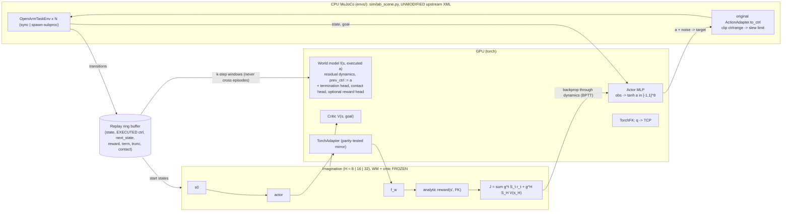

# Architecture (SuperMimic-style, OpenArm)

Training loop per iteration: **collect** (policy + noise; warmup random) -> **fit world model** (k-step autoregressive window loss on executed actions + termination BCE + optional contact/reward) -> **imagine** (actor update with finite-gradient and element-wise clipping; WM and critic frozen) -> **critic** fit to lambda-returns -> periodic **evaluation** on held-out goal seeds -> **checkpoint** (latest/best + manifest sha256).

State vector (34, PRIVILEGED): `q(8) dq(8) prev_ctrl(8) box_pos(3) box_quat(4) box_vel(3)`. Reaching actor input = proprioception + FK TCP + goal (deployable); pushing / pick-place actor input additionally contains the box state (needs perception on a real robot).

Studio integration: `studio_adapter.py` (stdlib + numpy, read-only) -> optional `/api/supermimic/*` hook (`studio/app_hook.patch`, not applied).
